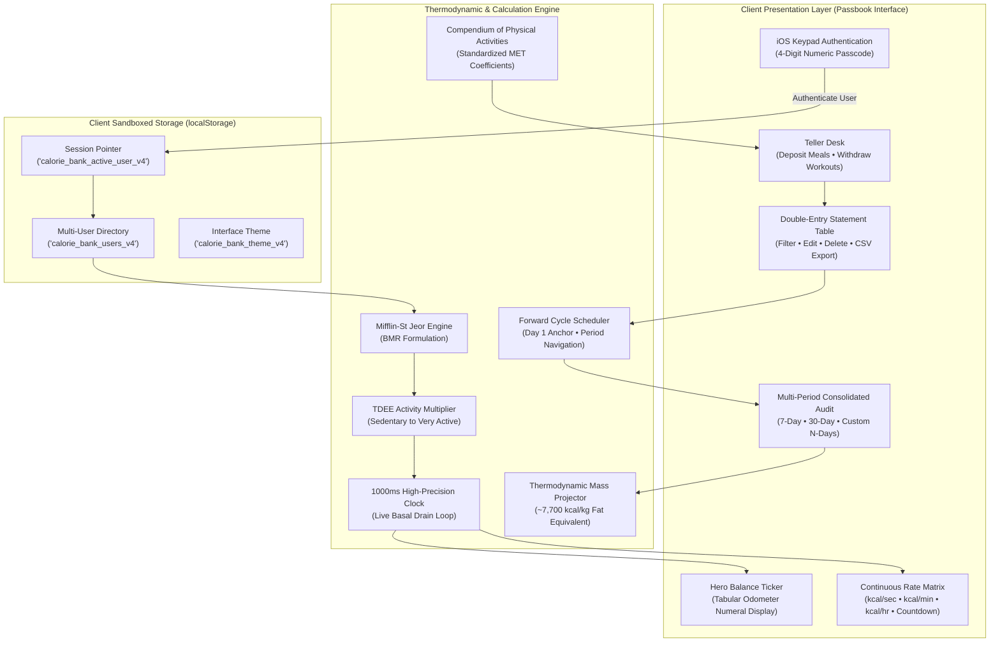
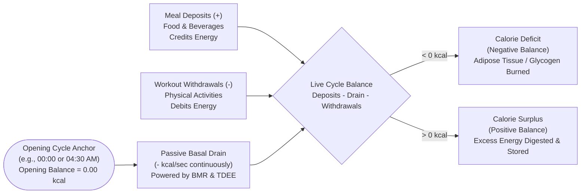

# The Calorie Bank & Reserve
### A Continuous Thermodynamic Metabolic Passbook Ledger

A single-page, zero-dependency financial passbook application that models human metabolism as a double-entry bank account. Rather than monetary currency, **The Calorie Bank** accounts for thermodynamic energy (**kcal**). Basal metabolic expenditure continuously drains the account second-by-second in real-time, meal deposits credit calories into the vault, workout withdrawals debit energy, and forward-looking consolidated audits calculate your net calorie stance and projected adipose tissue change.

---

## Architecture & System Design

---

## Transaction & Balance Lifecycle

---

## Scientific Methodology & Mathematical Foundations

### 1. Basal Metabolic Rate (BMR)
Basal metabolism is calculated using the **Mifflin-St Jeor predictive equation** (1990), recognized by the Academy of Nutrition and Dietetics as the most clinically accurate predictive standard for non-obese and obese individuals:

* **For Men**:
  $$\text{BMR} = 10 \times \text{weight (kg)} + 6.25 \times \text{height (cm)} - 5 \times \text{age (y)} + 5$$
* **For Women**:
  $$\text{BMR} = 10 \times \text{weight (kg)} + 6.25 \times \text{height (cm)} - 5 \times \text{age (y)} - 161$$

### 2. Total Daily Energy Expenditure (TDEE)
TDEE scales BMR by physical activity lifestyle factors:
$$\text{TDEE} = \text{BMR} \times \text{Activity Factor}$$
* Sedentary (desk work, minimal movement): $\times 1.2$
* Light Activity (1–3 days/week exercise): $\times 1.375$
* Moderate Activity (3–5 days/week moderate workout): $\times 1.55$
* Active (6–7 days/week hard exercise): $\times 1.725$
* Very Active (athletic training, physical labor): $\times 1.9$

### 3. Continuous Second-by-Second Basal Drain
Unlike conventional trackers that deduct energy only once daily, The Calorie Bank drains metabolism continuously:
$$\text{Rate per Second} = \frac{\text{TDEE}}{86,400\text{ seconds}}$$
$$\text{Cumulative Passive Burn} = \text{Rate per Second} \times \Delta t_{\text{elapsed since cycle cutoff}}$$

### 4. Exercise Expenditure via MET Multipliers
Physical exertion calories are derived from standardized **Metabolic Equivalent of Task (MET)** values from the Ainsworth Compendium of Physical Activities:
$$\text{Kcal Burned} = \left(\frac{\text{MET} \times 3.5 \times \text{Body Weight (kg)}}{200}\right) \times \text{Duration (minutes)}$$

### 5. Multi-Period Consolidated Audit & Forward Cycle Algorithm
Cycles anchor to the user's registration date (e.g., **Day 1 (1st) on Saturday, Oct 31**):
* **Forward Horizon**: Displays forward progression across Day 1, Day 2, up to Day $N$.
* **Audit Stance Equation**:
  $$\text{Net Stance} = \sum_{i=1}^{\text{active}} \text{Daily Calorie Excess} - \sum_{i=1}^{\text{active}} \text{Daily Calorie Deficit}$$
* If $\text{Net Stance} < 0$: **Caloric Deficit is winning**.
* If $\text{Net Stance} > 0$: **Caloric Surplus is winning**.

### 6. Projected Physiological Mass Storage / Loss
Using standard human adipose tissue energy density approximations ($\approx 7,700\text{ kcal/kg}$ or $\approx 3,500\text{ kcal/lb}$):
$$\Delta \text{Body Fat Mass (kg)} = \frac{\text{Net Caloric Stance (kcal)}}{7,700}$$

---

## Key Features

1. **Double-Entry Financial Passbook Ledger**:
   - Modern editorial financial design with warm off-white and deep warm charcoal palettes.
   - Ember orange/red accent ($#E64A19$); green and red strictly reserved for surplus and deficit.
   - Monospace tabular numerals to prevent layout jitter during real-time 1-second ticks.

2. **iOS-Style 4-Digit Passcode Protection**:
   - Tactile circular numeric buttons with alpha legends (`ABC`, `DEF`, etc.).
   - Ink-fill passcode dots, shake animation on invalid entry, and full physical keyboard support (`0`–`9`, `Backspace`, `Escape`).

3. **Multi-User Sandboxed Storage**:
   - Create and switch between multiple user profiles on a single machine.
   - Complete data isolation in `localStorage` for transactions, biometrics, custom cutoff hours, and historical cycles.

4. **Minute-Level Custom 24-Hour Cycle Reset**:
   - Configurable cutoff time (e.g. `00:00`, `04:30 AM`, `06:15 AM`) to match non-standard sleep cycles or shift work.

5. **Multi-Period Consolidated Audit (7-Day, 30-Day, Custom Window)**:
   - Forward schedule starting from your account creation date.
   - Real-time live pulse on today's active row.
   - Pre-plan or adjust entries for upcoming or past days.
   - Cycle navigation controls (`‹ Prev Period`, `Next Period ›`, `Restart Cycle Today`).

6. **Zero Dependencies**:
   - Self-contained single-file HTML/CSS/JavaScript. No Node build tools, no npm modules, no external servers required.

---

## Deploying to Netlify

Deploying this repository to Netlify takes under 30 seconds. Choose either of the two methods below:

### Method 1: Netlify Drop (Instant Drag-and-Drop)

1. Open your browser and navigate to **[app.netlify.com/drop](https://app.netlify.com/drop)**.
2. Sign in to your Netlify account (or sign up for free).
3. Open your Mac **Finder** and locate the **`calorie bank`** folder on your Desktop (`/Users/shaikaahil/Desktop/calorie bank`).
4. **Drag the entire `calorie bank` folder** directly onto the designated upload box in your browser window.
5. Netlify will instantly upload the static files and publish your website with a live URL (e.g., `https://elastic-curie-xxxxxx.netlify.app`).
6. *(Optional)* Click **Site configuration > Change site name** to give your site a custom domain (e.g., `https://calorie-bank.netlify.app`).

### Method 2: GitHub Continuous Deployment

1. Go to **[app.netlify.com](https://app.netlify.com)** and click **"Add new site" > "Import an existing project"**.
2. Select **GitHub** and authorize access to your account (`Aahil101`).
3. Select the repository: **`Aahil101/calorie-bank`**.
4. The deployment settings will be detected automatically from [`netlify.toml`](./netlify.toml):
   * **Build command**: *(leave blank)*
   * **Publish directory**: `.`
5. Click **Deploy calorie-bank**.
6. Every time you push new commits to the `main` branch, Netlify will automatically rebuild and deploy your site in real time!

---

## Technical Specifications

| Component | Technology / Standard |
| :--- | :--- |
| **Markup & Layout** | HTML5 Semantic Elements, CSS Grid & Flexbox |
| **Typography** | Playfair Display (Serif Editorial Display), JetBrains Mono (Tabular Numerals) |
| **Metabolic Formulas** | Mifflin-St Jeor (1990), Compendium of Physical Activities (Ainsworth et al.) |
| **State Management** | LocalStorage API (`JSON` serialization with fallback schema migrations) |
| **Security Headers** | Configured in `netlify.toml` (`X-Frame-Options: DENY`, `X-Content-Type-Options: nosniff`, `CSP`) |
| **Runtime Target** | Modern Evergreen Browsers (Chrome, Safari, Firefox, Edge, iOS Safari) |

---

## Medical Disclaimer

Values provided by **The Calorie Bank** are calculated mathematical estimations derived from metabolic predictive equations and standardized MET coefficients. Actual energy expenditure and body mass variations depend on thyroid function, glycogen depletion, hydration levels, and individual bio-individuality. This application is designed solely for self-accounting tracking and does not constitute clinical, nutritional, or medical counsel.

---

&copy; 2026 The Calorie Bank &bull; MIT License
